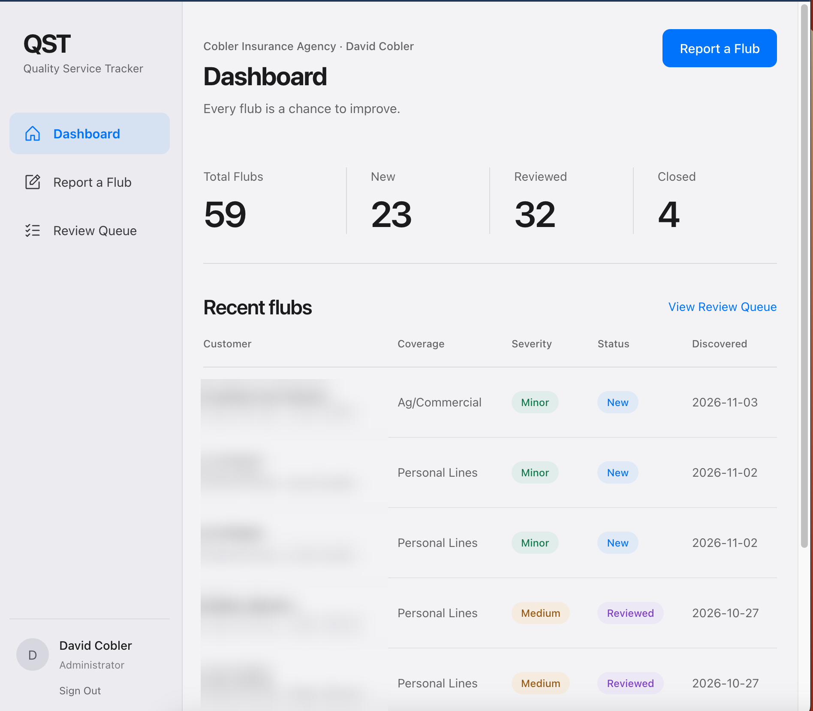

# QST: Quality Service Tracker

*Case study. The code is private because it handles client data.*

**Why:** We needed a better way to track errors and performance across our team.

**What it does:** Staff log every "flub" with customer, coverage line, severity and category. Managers work a review queue (New → Reviewed → Closed), and the dashboard pinpoints the lines of business, staff and processes most in need of training.

**Results:** In use across a $15M agency collective; 59 flubs logged so far.

**Built with:** TypeScript; Claude and ChatGPT as coding partners; GitHub, Vercel, VS Code.

*Customer and staff names blurred for privacy.*
